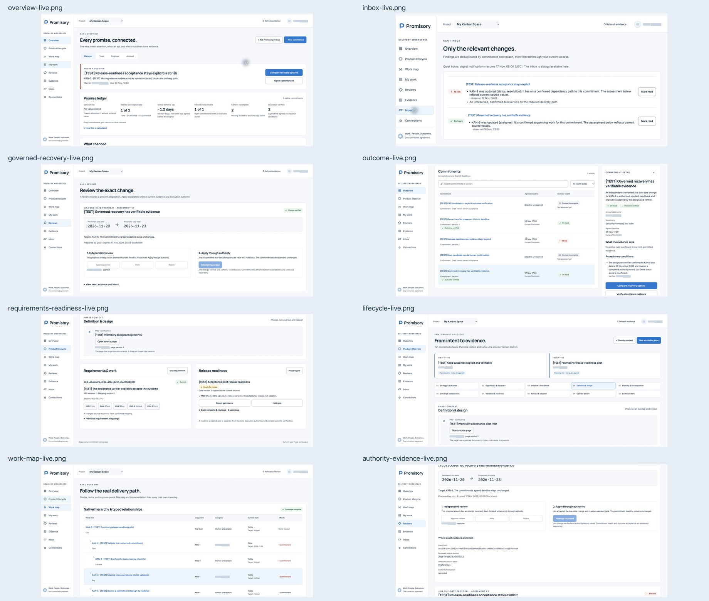

# Enhanced UI live capture — 17 November 2026

Remote `master` was fast-forwarded to `092c2f7` before these builds and captures. Existing local release fixes and unrelated submission drafts were preserved.

## Build verification

- 186 unit/contract tests in 30 files passed.
- 20 browser checks passed. Those checks use local fixtures; their images are not submission screenshots.
- Typecheck, UI build, remote build, generated manifest validation, Forge bundle, and release-profile equivalence passed.
- The enhanced UI deployed as development **4.2.0**, judge production **3.1.0**, and Marketplace production **4.1.0**.
- The installed development app served resource `e34cadc2-a3b5-4d0e-907f-6d6faac9197d` on the Decionis Promisory test site.

See [checks.json](checks.json) for the shared source digest and measured results.

## New screenshots

The [capture package](../../submission/assets/ui-retake-2026-11-17/manifest.json) contains eight new screenshots, three Marketplace previews, and a Devpost thumbnail. All product images come from the installed app, with explicitly labelled test records. No example-mode or browser-test fixture images are used.

The views cover the decision card and promise ledger, grouped change inbox, a completed governed Jira change, explicit outcome verification, versioned Confluence requirements, release readiness, lifecycle context, actual Jira hierarchy, and exact authority evidence. The evidence screenshot shows the already completed KAN-6 operation; it does not claim that this capture caused a new write.

Browser chrome was cropped, account names and initials were redacted, and images were resized proportionally. UI values and result states were not rewritten. No Teamwork Graph relations or derived counts are included in the exported images. The manifest records source timestamps, crop rectangles, privacy masks, and file hashes.

## Remaining recording and uploads

The user resumed video production for the enhanced UI. A fresh continuous screen recording is still required. The Mac locked while the live Rovo agent was fetching its response; automatic unlock failed. The Rovo response capture and new recording are therefore unfinished. The earlier video under `release/video/paused-export` is preserved and is not the enhanced-UI deliverable.

QuickTime's recording toolbar did not launch through the available computer controls. Explicit authorization to use the built-in macOS video-recording command is pending. The planned recording excludes microphone input; conversational synthetic narration and the user's requested quiet soundtrack are added during editing.

The new screenshots have not yet replaced the saved Devpost gallery or Marketplace listing images. Marketplace remains pending approval and its listing is locked for ordinary edits; new assets may need to be supplied through the existing review ticket. No claim of a completed video or published listing is made here.
