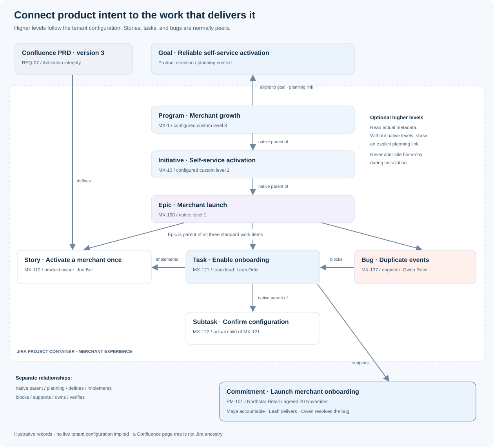
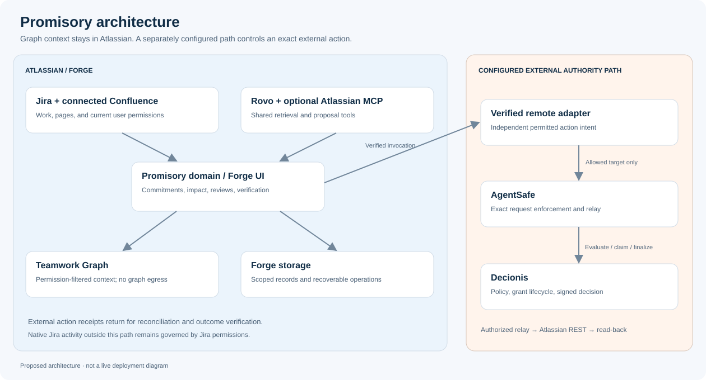

# Promisory · Technical specification
**Version 1.0 · 10 November 2026 · Proposed product**

## 1. Product definition

Promisory connects a commitment to the work, people, decisions, and evidence that determine whether it will be kept. A project manager can trace a threatened launch down to a blocking bug; the engineer working on that bug can see the commitments and stakeholders affected above them. Customer-facing promises and internal delivery commitments share this model. The scope begins above epics, with product direction, goals, initiatives, and Confluence discovery/requirements, and continues through release, operation, learning, and retirement.

The primary users are engineering and product delivery teams at B2B software companies. Customer success and support participate as commitment owners and stakeholders. The first buyer is a head of delivery, engineering manager, or product operations lead. A project is the initial installation scope; cross-project portfolios expand only after access and ownership are understood.

**Product promise:** understand what is at risk, identify the responsible people, choose a permitted next action, and establish whether the promised outcome actually happened.

### Expected outcomes and pilot hypotheses

These are targets to validate, not measured performance claims.

| Outcome | Pilot measure | Initial target |
|---|---|---|
| Useful immediately | Time from authorized project selection to first evidence-linked finding | Under 10 minutes for the bounded pilot dataset |
| Fewer unowned commitments | Active commitments with a confirmed accountable owner | At least 95% |
| Earlier intervention | Time between an observed dependency change and a visible impact update | Under 2 minutes at p95 in the test tenant |
| Less status chasing | Time spent preparing a weekly commitment review | 30% reduction against the team's own baseline |
| Better follow-through | Commitments fulfilled by the original agreed due date / commitments due | Improve over a four-week baseline; no invented uplift |
| Credible completion | Fulfilled commitments with qualifying evidence and an attributable verification | 100% |
| Trusted adoption | Weekly returning pilot teams and their confirmed useful findings | Track team-level retention and finding acceptance |

Use the original commitment deadline as well as any agreed revised deadline when measuring outcomes. Renegotiating a deadline must not erase an earlier breach. Report cancelled, superseded, and late-fulfilled commitments separately.

## 2. Model work and accountability accurately

### Work topology

A Jira project is a container, not a work item's parent. Jira's normal work hierarchy places an epic above standard work types such as story, task, and bug; subtasks sit below a standard work item. Extra levels are tenant-dependent. Promisory must discover actual work types and parent relationships rather than infer them from names. [Jira hierarchy reference](https://support.atlassian.com/jira-cloud-administration/docs/configure-the-issue-type-hierarchy)

~~~text
Planning context: product vision, goals, and initiative outcome
Confluence artifacts: discovery, PRD, release readiness, outcome review

Jira project: Merchant Experience (container)
  Program: Merchant growth (configured custom level in this example)
    Initiative: Self-service activation (configured custom level)
      Epic: Merchant launch
        Story: Activate a merchant once
        Task: Enable production onboarding
          Subtask: Confirm tenant configuration
        Bug: Duplicate onboarding events

Bug --blocks--> Task --supports--> Commitment
Task --implements--> Story
PRD requirement --defines--> Story / Task acceptance
Initiative --aligns to--> Product goal
Commitment --belongs to--> Project
Commitment --accountable to--> Delivery owner
Task/Bug --assigned to--> Engineer
Delivery owner --coordinates with--> Team lead / Product owner / Scrum master
Commitment --benefits--> Customer or internal stakeholder
~~~

The user's desired project → epic → task → bug trace is supported as an **impact path**: a bug can block a task inside an epic without being fabricated as its child. A custom tenant hierarchy is preserved where it genuinely exists.

Store containment, hierarchy, dependency, accountability, and evidence as different edge types. An engineering dependency is not an organizational reporting line. A Jira project and an Atlassian project/goal are different entity types with separate identifiers.

### Full product lifecycle and planning context

Promisory connects ten lifecycle phases: strategy and outcomes; opportunity and discovery; initiative and investment; definition and design; planning and decomposition; delivery and collaboration; validation and readiness; release and adoption; operate and learn; evolve or retire. Phases can overlap and repeat. A phase is not a Jira hierarchy level.

Confluence provides the source artifacts: vision/OKRs, research, initiative charter, business case, roadmap, PRD, design and architecture decisions, epic briefs, story maps, test/UAT evidence, launch plan, runbooks, outcome reviews, retrospectives, and retirement plans. Users map existing pages to these artifact roles. Page trees organize documents; they do not create Jira parent relationships.

| Planning / delivery layer | Promisory behavior |
|---|---|
| Vision, objectives, key results, themes | Link intended outcomes, baselines, owners, and review horizons |
| Portfolio, program, product, initiative | Show explicit planning context; import genuine custom Jira parents where configured |
| Opportunity, idea, PRD, capability/feature brief | Keep source versions and confirmed requirement/work links |
| Epic | Connect scope and requirements to actual child work |
| Story, task, bug, configured spike/test types | Preserve standard-work peers; use implementation/blocking links to trace between them |
| Subtask | Preserve the actual standard-work parent |
| Milestone, sprint, release/version | Associate schedule and readiness without inventing parent levels |
| Release, adoption, operation, learning | Verify separate delivery and business acceptance conditions; create new improvement commitments |

Native levels above Epic require the tenant's supported Jira configuration; Premium/Enterprise can provide these custom levels. Promisory reads them without modifying the site hierarchy. With no native initiative level, a Confluence initiative can still link to epics through a clearly labelled planning relationship. [Custom hierarchy reference](https://support.atlassian.com/jira-software-cloud/docs/configure-custom-hierarchy-levels-in-advanced-roadmaps/)

The requested epic → story → task/bug trace is available as typed relationships. Standard Jira stories and tasks are normally peers; implementation subtasks can be real children of a story or task. A bug can block either. Do not create a false Story → Task → Bug native hierarchy.

Each required PRD section receives a stable requirement reference tied to the page ID, revision, section mapping, and content fingerprint. A versioned lifecycle gate records required artifacts, conditions, and designated reviewers. Source changes can invalidate current gate applicability without rewriting historic reviews. A ready gate, a permitted external action, and a verified outcome remain distinct.

P0 covers all phases as context and proves one continuous path from goal/initiative and a selected PRD through work to release readiness and a commitment. It does not automate every business process in every phase. See the [complete lifecycle matrix, Confluence blueprint, and traceability rules](06-product-lifecycle-and-traceability.md).

### Ownership and stakeholder roles

| Role | View and responsibilities | Authority boundary |
|---|---|---|
| Sponsor / senior manager | Project commitments, exceptions, business impact, unresolved tradeoffs | Sees only permitted data; job title alone grants no approval power |
| Product leader / initiative owner | Strategy, product outcomes, investment decisions, requirements coverage | Explicit scope and review rights; title is not execution authority |
| Researcher / designer / architect | Discovery evidence, experience/architecture decisions, requirement assumptions | Contributes evidence and scoped reviews without silently changing commitments |
| QA / release / service owner | Validation, release readiness, support handover, production and adoption evidence | Verifies designated conditions; a release decision does not override institutional execution policy |
| Project / delivery manager | Accountable owner, milestones, stakeholder coordination, review queue | Can accept or change commitments only within configured rights |
| Product owner | Scope, acceptance criteria, outcome priorities | Scope changes create a proposed revision |
| Subteam / team lead | Team dependencies, unassigned work, handoffs | Owns team coordination; does not inherit all customer authority |
| Scrum master / facilitator | Sprint blockers, aging decisions, ceremonies, follow-through | Facilitates action; no automatic authority to override priorities |
| Engineer / tester | Assigned work, upstream impact, evidence requests, implementation updates | Changes permitted work; cannot certify unrelated business outcomes |
| Support / account owner | Customer promises, affected accounts, update drafts, recovery options | External recipients and messages require separate permission checks |
| Stakeholder / observer | Subscribed, permission-filtered updates | Read and comment rights remain explicit |
| Org / site administrator | Installation, scopes, project inclusion, connections, retention | Administrative access does not replace institutional policy approval |
| Designated approver | Review a specific proposed action and its evidence | Approval is scoped to the exact version and action |

Each active commitment has exactly one accountable owner, plus zero or more delivery owners, contributors, approvers, and observers. An owner change requires the incoming owner to accept it; until then, display “Owner transfer pending” and retain the current owner. An inactive or inaccessible owner produces an ownership gap.

Team membership is discovered where available and confirmed by an administrator. Reporting managers, subteam structures, scrum roles, and decision rights are never inferred from document authorship, titles, or communication frequency. Store role scope and provenance. Role changes take effect at the next authorized read and before any action.

### Core terminology

- **Commitment:** a versioned agreement about an outcome, beneficiary, deadline, owner, and acceptance conditions.
- **Work item:** an external Jira record, identified by stable ID and cloud ID. Its key is a display value that may change.
- **Impact path:** a typed, explainable route from changed work to an affected commitment.
- **Evidence:** a source reference, observation time, source revision, applicability, and verification result.
- **Review:** a person's recorded disposition on a particular proposal.
- **Execution authority:** Decionis's decision and applicable execution grant for an exact action.
- **Fulfillment:** the acceptance conditions were satisfied and verified; closing a Jira item is only evidence when the agreed condition explicitly says so.

## 3. Feature catalogue

P0 is the hackathon release. P1 follows once P0 acceptance gates pass. P2 is the product roadmap. Priority refers to implementation sequence, not the value of the feature.

| ID | Capability | Priority | Acceptance outcome |
|---|---|---|---|
| F01 | Project-scoped onboarding and connection diagnostics | P0 | Admin selects scope; users see actual access, import progress, and missing capabilities |
| F02 | Jira hierarchy and dependency synchronization | P0 | Epics, standard items, subtasks, links, deletions, and moves map correctly |
| F03 | Commitment capture with structured confirmation | P0 | Every activated commitment has outcome, owner, deadline, beneficiary, and acceptance conditions |
| F04 | Rovo-assisted extraction from selected sources | P0 | AI produces candidates with citations; ambiguous dates or owners remain unresolved |
| F05 | Ownership and stakeholder map | P0 | Each displayed role has scope and provenance; unowned work is visible |
| F06 | Project / epic / work-item impact explorer | P0 | A selected bug shows a deduplicated route to each affected commitment |
| F07 | Deterministic impact assessment | P0 | Risk reasons are reproducible from versioned rules and authorized facts |
| F08 | Role-specific workspaces | P0 | Manager, team, engineer, and account views use the same underlying authorized records |
| F09 | Change feed and commitment history | P0 | Scope/date/owner changes preserve before-and-after values and source references |
| F10 | Recovery proposal comparison | P0 | User compares repair, scope reduction, and renegotiation without silently changing a promise |
| F11 | Review and controlled action | P0 | Exact proposal is reviewed, authorized, executed through the selected boundary, and reconciled |
| F12 | Fulfillment verification and reopening | P0 | Evidence satisfies the versioned acceptance conditions; later regressions remain visible |
| F13 | Permission-aware Teamwork Graph context | P0 | Real graph queries enrich team, work, and evidence context without access expansion |
| F14 | Rovo agent with reusable tools | P0 | Agent explains a real impact path and creates a reviewable proposal |
| F15 | In-app inbox and quiet digests | P0 | Deduplicated, role-relevant notices link to evidence; sensitive content is not leaked |
| F16 | Confluence commitment and lifecycle macro | P0 | Connected pages show authorized commitments, requirement applicability, and lifecycle readiness |
| F17 | Fixture mode and judge onboarding | P0 | Explicit example data and repeatable installation instructions support a fresh judge tenant |
| F18 | Marketplace-ready distribution | P0 | Listing materials, privacy details, support route, and a functioning test release exist |
| F19 | Atlassian MCP tools | P1, bonus target | The Forge rovo:mcp module exposes useful read/proposal tools through Atlassian |
| F20 | Cross-project portfolio and shared dependency conflicts | P1 | A shared dependency is counted once per commitment; restricted projects remain hidden |
| F21 | Sprint planning and scrum ceremony packs | P1 | Planning, standup, review, and retrospective views summarize current commitments |
| F22 | Customer update workflow | P1 | Approved recipient and exact text are checked again before sending; no auto-send from extraction |
| F23 | Capacity-aware scenario comparison | P2 | Explicit team capacity inputs support scenarios with stated assumptions |
| F24 | External CRM / deployment / service connectors | P2 | Each connector has permission, freshness, lineage, and deletion contracts |
| F25 | Delivery forecasting and trend models | P2 | Calibrated evaluations justify uncertainty estimates before probabilities appear |
| F26 | Verified customer-facing status portal | P2 | A separate public model exposes only expressly approved information |
| F27 | Reusable commitment and policy templates | P1 | Teams can adopt templates without silently publishing institutional policy |
| F28 | Billing and enterprise lifecycle controls | P1 | Entitlements, export, uninstall, retention, and support are exercised end to end |
| F29 | Strategy, initiative, and higher-level context | P0 | Import actual higher Jira levels or show explicit planning links; never change site hierarchy |
| F30 | Confluence product lifecycle workspace | P0 | All ten phases map to selected source artifacts, owners, and evidence states |
| F31 | Requirement-to-work-to-outcome traceability | P0 | Stable PRD references connect to epics, stories, tasks/bugs, and acceptance evidence |
| F32 | Versioned readiness and requirement drift | P0 | A changed PRD or missing required evidence invalidates the applicable readiness review |
| F33 | Outcome review and retrospective follow-through | P1 | Learning produces owner-confirmed improvement commitments; adoption differs from release |
| F34 | Migration, deprecation, and retirement workflows | P2 | Affected stakeholders and completion evidence govern product retirement commitments |
| F35 | Confluence artifact template preparation | P1 | Prepare lifecycle documents and exact publication changes for an authorized workflow |

P0 is feature-rich but deliberately bounded to one site, a small set of selected Jira projects, optional connected Confluence, and one real governed mutation type. No organization-wide interception or automatic engineering resource allocation is claimed.

## 4. End-to-end workflows

### A. Install and receive useful context

1. An organization administrator installs Promisory with the requested graph scopes, selects a pilot Jira project, and optionally connects Confluence.
2. Connection diagnostics show what is authorized and available. Rovo or graph unavailability is visible; it is not represented as an empty, healthy portfolio.
3. A bounded import discovers actual hierarchy, links, assignments, and candidate commitment sources.
4. A manager confirms a small set of commitments and role mappings. Promisory highlights missing owners, unclear acceptance conditions, and conflicting deadlines.
5. The first useful result is an evidence-linked finding, not a compulsory dashboard configuration exercise.

A Jira-only installation remains useful for hierarchy and manually entered commitments. The full judged Rovo/graph experience must be demonstrated in a tenant with those capabilities and permissions.

### B. Manager creates a project commitment

1. Define a measurable outcome and a beneficiary, select project scope, assign an accountable owner, and set a local deadline with an explicit time zone.
2. Link the relevant epic or standard work items. Show discovered dependency suggestions separately from confirmed dependencies.
3. Define acceptance conditions and permitted evidence types. Choose stakeholders and review rules.
4. The owner confirms the commitment. The system records an immutable version, the original due date, and the source references.
5. The owner and affected team members receive permission-filtered in-app notices.

For an external promise, record who is entitled to make it and what was actually communicated. An internal draft does not become a customer agreement merely because an AI extracted it.

### C. Engineer discovers a blocking bug

1. Jira reports a change; Promisory refetches the current authorized record rather than trusting a stale event payload.
2. The impact engine traverses confirmed blocking links and support relationships.
3. The issue panel shows the engineer which commitments are affected, why, and who should coordinate the response.
4. Managers see the affected outcome; team leads see the dependency; the scrum facilitator sees the impediment; the account owner sees a customer communication task.
5. One incident/change creates one review item per affected commitment and reason. Repeated events update that item instead of spamming all participants.

### D. Compare and approve a recovery proposal

1. Present explicit alternatives: resolve the blocker, reduce scope while preserving stated acceptance conditions, or propose a new date.
2. Each alternative shows affected commitments, assumptions, the responsible person, evidence age, and the permissions needed.
3. The owner selects a proposal. A designated approver reviews the exact proposed change where policy requires it.
4. On apply, recheck user permissions, commitment version, live source state, policy binding, and action payload.
5. The configured executor uses AgentSafe and Decionis. A hold or refusal leaves downstream state unchanged.
6. A successful write is read back and recorded. An uncertain result goes to reconciliation; it is not retried blindly.

For P0, the real downstream mutation is an approved Jira work-item due-date update. Internal commitment revision remains a separate domain event. Changing an engineering due date must not automatically change a customer promise. External email and refunds are outside P0.

### E. Verify fulfillment

1. The owner submits evidence or a connected source produces qualifying evidence.
2. The verifier evaluates each acceptance condition against the agreed version.
3. If the condition requires human acceptance, the designated person records it.
4. The commitment becomes fulfilled only after required conditions pass. Show whether fulfillment was on time or late.
5. Later regression evidence creates a visible regression event and a new review. Historical evidence and the original result are retained according to the retention policy.

A signed dossier proves the provenance and integrity of a decision record; it does not, by itself, prove that the external business outcome was true.

### F. Ask Rovo across the delivery chain

Example request: “What threatens Merchant Launch, who needs to act, and what can we do?”

Rovo calls permission-aware context and impact tools, returns a concise answer with source links, identifies unknowns, and offers a draft recovery proposal. The user opens the normal review screen to apply a change. An agent response cannot approve its own proposal.

### G. Follow a product from its PRD to a verified outcome

1. A product owner selects a permitted Confluence strategy/initiative brief and PRD, then confirms the outcome, artifact roles, requirement references, and accountable people.
2. Promisory connects the initiative to native higher-level Jira work where present, or to an explicitly labelled planning record. It maps requirements to epics and standard work without inferring parentage from page layout.
3. A requirement edit or blocking bug reveals affected commitments, linked initiative context, and readiness conditions. Relevant owners review the changed scope and evidence.
4. A release-readiness gate records the exact document/work versions and required acceptance. A changed source invalidates its current applicability.
5. Release evidence verifies the delivery conditions. Adoption or business metrics remain separate conditions with their own observation window.
6. An outcome review or retrospective proposes the next improvement commitment. Retirement and migration use the same ownership and evidence principles when those workflows are enabled.

See [the complete phase-by-phase workflow](06-product-lifecycle-and-traceability.md).

## 5. Information architecture and screen contracts

| Surface | Main content | Primary action |
|---|---|---|
| Product lifecycle | Phase, goal/initiative context, Confluence artifacts, owners, readiness, outcome measures | Inspect source applicability or follow the requirement trace |
| Portfolio / overview | Commitments due, changed risks, owner gaps, freshness, pending decisions | Review the most consequential change |
| Project workspace | Project outcome, epics, dependencies, stakeholder map, commitment rollup | Trace an affected commitment |
| Commitment detail | Versioned agreement, acceptance conditions, delivery links, history, evidence | Propose a recovery or verify fulfillment |
| Work map | Expandable hierarchy plus typed dependency paths | Select a blocker and inspect upstream impact |
| Jira issue panel | Upstream commitments, accountable owner, evidence requests | Open the impact path |
| My work | Assigned work and the commitments it supports | Update evidence or request coordination |
| Reviews | Exact before/after change, reviewers, policy response, expiry | Review and apply an authorized proposal |
| Evidence | References, source revisions, verification status, access, freshness | Refresh or supply missing evidence |
| Confluence macro | Current authorized commitment card with a link to details | Open the linked commitment |
| Settings | Scope, roles, connections, notices, retention, billing | Change configuration with proper admin rights |

Use counts and dates before abstract scores. Missing data has an explicit state. Each view offers a table/list alternative to graphs and retains the selected project, filters, and scroll position across navigation.

## 6. Domain model and state machines

### Main records

| Record | Required fields and invariants |
|---|---|
| TenantInstallation | appId, environmentId, installationId, cloudId, linked products, status; server-derived scope |
| PlanningNode | Kind, stable ID, owner, source, scope, optional native-work binding; goals/products are not presumed Jira parents |
| LifecycleArtifact | Artifact role, phase, Confluence page/space ID, source revision, section mapping, review provenance |
| RequirementRecord | Stable requirement ID, artifact/version, content fingerprint, acceptance conditions, confirmed work links |
| LifecycleGate | Phase, required artifact/requirement versions, condition set, reviewers, readiness, applicability, reason |
| WorkNode | stable external ID, cloudId, external type, project ID, parent ID, display key, current status, source revision |
| WorkEdge | from/to stable IDs, typed relationship, source, confirmed/discovered state, observedAt |
| Commitment | ID, version, title, outcome, beneficiary reference, accountableOwner, project scopes, originalDueAt, agreedDueAt, timeZone, lifecycle |
| AcceptanceCondition | stable ID, version, measurable predicate, evidence type, applicability, required verifier |
| StakeholderBinding | commitment/project/team scope, accountId or team ID, role, provenance, confirmedBy, validity |
| EvidenceReference | source type, source ID, source revision, observedAt, checkedAt, freshness policy, visibility, lineage, verification |
| ImpactAssessment | commitment version, rule version, source revisions, reasons, affected paths, known/unknown coverage |
| RecoveryProposal | target commitment version, alternative, exact requested effect, creator, expiry, evidence references |
| ReviewRecord | proposal ID, proposal hash, reviewer identity, disposition, timestamp, authority role reference |
| ActionOperation | immutable intent hash, tenant/principal, idempotency key, decision/grant references, stage, external receipt |
| OutcomeRecord | commitment version, condition results, evidence references, verifier, verifiedAt, timeliness |
| NotificationItem | recipient scope, commitment, reason, severity, dedupe key, seenAt; no unrestricted source copy |

A commitment can cover multiple work items and multiple stakeholders. Shared work is normalized once. The same issue key on two Jira sites represents different records.

### Separate lifecycle, health, and execution

~~~text
Commitment:
DRAFT → PROPOSED → ACTIVE → FULFILLED
                   ├→ CANCELLED
                   └→ SUPERSEDED by a new active version

Health of a commitment:
ON_TRACK | WATCH | AT_RISK | BREACHED | UNKNOWN

Action operation:
PREPARED → EVALUATED → AWAITING_REVIEW or HELD or BLOCKED
                    → AUTHORIZED → EXECUTING → SUCCEEDED
                                              ├→ FAILED
                                              └→ RECONCILING
~~~

An ACTIVE commitment may be AT_RISK. A FULFILLED commitment may have been fulfilled late. A review approval is not the AUTHORIZED action state; authority is established by the configured Decionis execution contract. An unfamiliar decision, missing grant, expired grant, or shadow-mode decision cannot enter the live execution branch.

Lifecycle readiness is separately recorded as UNKNOWN, NOT_READY, READY_FOR_REVIEW, ACCEPTED, HELD, SUPERSEDED, or NOT_APPLICABLE. A NOT_APPLICABLE disposition needs an authorized, recorded reason. Confluence page publication does not itself mean acceptance. A source change can supersede applicability while preserving the historic accepted gate.

### Date and revision rules

Store instants in UTC and preserve the IANA time zone used to agree the deadline. A date-only promise must be converted using an explicitly selected local cutoff; never silently assume midnight. Jira's date-only due date and a commitment's timestamp are distinct fields.

Use optimistic concurrency on every commitment and proposal update. A changed source revision or proposed payload invalidates earlier review applicability. A source update after verification is handled as a new event, not as an edit to the historic verification.

See [the proposed contracts](contracts/domain-contracts.ts) and [example fixture](contracts/demo-scenario.json).

## 7. Impact engine

Promisory computes delivery diagnostics, not institutional execution permission.

1. Normalize the changed item and refetch its authoritative current state.
2. Traverse confirmed dependency and support edges using a visited set, depth and node budgets, and stable IDs.
3. Resolve each affected commitment once, retaining all explanatory paths.
4. Evaluate deterministic, versioned rules against authorized evidence.
5. Record reasons, freshness, missing evidence, and the source revisions used.
6. Upsert the matching finding and notify only the relevant authorized audience.

### Initial rule set

| Reason | Condition | Result |
|---|---|---|
| DEADLINE_PASSED | Current time exceeds agreed deadline and required outcome is unverified | BREACHED |
| BLOCKING_DEFECT | An unresolved confirmed blocking defect lies on a required path | AT_RISK |
| DELIVERY_AFTER_PROMISE | Explicit forecast/target date exceeds the commitment deadline | AT_RISK |
| UNACCEPTED_OWNER | Active commitment lacks an accepted accountable owner | AT_RISK |
| STALE_EVIDENCE | A required source exceeds its permitted age | UNKNOWN coverage; show the known risk separately |
| INCOMPLETE_SCOPE | Required paths cannot be inspected or import is incomplete | UNKNOWN coverage |
| REQUIREMENT_CHANGED | A required accepted source/requirement revision changed | Reassessment needed; WATCH unless a stronger known risk applies; gate applicability is stale |
| GATE_NOT_READY | A required readiness condition explicitly fails | Explain the failed condition; AT_RISK when it threatens the commitment; absent evidence remains unknown |
| OUTCOME_UNMEASURED | The agreed business outcome has no qualifying measurement yet | UNKNOWN coverage; do not infer adoption from release |
| DUE_SOON | Deadline falls inside a configured warning window, with incomplete required work | WATCH |
| VERIFIED_PROGRESS | No active rule and all required coverage is current | ON_TRACK |

A root rollup exposes separate counts for breached, at-risk, watch, unknown, and on-track commitments. It does not average away one severe blocker. A known breach and incomplete visibility can coexist; show both.

“No returned graph rows” never means “no dependencies.” It can mean missing permissions, disabled scopes, unsupported relationships, or unavailable data. Cycles are surfaced as data-quality findings and traversal terminates deterministically. User-confirmed links remain distinguishable from model-suggested links.

## 8. Technical architecture

### Selected stack

- Forge app with TypeScript, React Custom UI, and a Vite build for the rich project workspace.
- Native Forge UI Kit where a small issue panel or admin surface benefits from it.
- Forge functions for resolvers, Rovo tools, event handling, and scheduled reconciliation.
- Forge SQL for normalized records and indexed queries; KVS secret storage for small per-installation secrets/configuration where required.
- Versioned domain and integration contracts with runtime validation.
- A small TypeScript remote adapter for the optional, explicitly enabled governed execution path; reuse existing Decionis and AgentSafe services.
- Playwright for interaction and integration evidence, with unit/contract tests for the domain and authority boundaries.

Pin currently supported runtime and package versions in Phase 0. The existing kit uses Node 22; do not copy its runtime assumption without checking current Forge support. Avoid introducing a second language or separate agent runtime for P0.

~~~text
Jira / Confluence UI + Rovo / Atlassian MCP
                  |
             Forge functions
                  |
       Promisory domain + Forge storage
          /                     \
Teamwork Graph + Jira REST       Verified remote invocation
(read context in Atlassian)       (approved independent action data)
                                          |
                               Promisory remote adapter
                                          |
                                  AgentSafe gateway
                                     /         \
                            Decionis authority  Atlassian REST
                                     \         /
                                    operation receipt
                                          |
                              reconciliation / outcome
~~~

### Forge module plan

Use actual manifest keys supported by the current CLI, not names inferred from product marketing.

| Purpose | Module / mechanism |
|---|---|
| Main workspace | jira:globalPage and/or jira:projectPage |
| Issue context | jira:issuePanel |
| Configuration | jira:adminPage |
| Confluence card | macro |
| Agent | rovo:agent plus action modules |
| Optional reusable MCP tools | rovo:mcp referring to the same action keys |
| Work updates | trigger with supported Jira/Confluence events |
| Reconciliation | scheduledTrigger plus bounded asynchronous jobs |
| External executor | remote / endpoint with verified Forge invocation tokens |

The Confluence macro manifest key is **macro**, not an invented confluence:macro key. The documented Rovo function module is **action**; verify the generated manifest rather than copying the rovo:action label returned as display metadata by the old Decionis route.

### Storage and concurrency

Keep aggregate updates safe using version-checked, single-statement writes and unique operation/event identifiers. Do not assume Forge SQL supports arbitrary multi-statement transactions. Test its current atomicity and concurrency behavior before selecting repository methods.

Maintain a recoverable operation state machine: record intent before dispatch, atomically claim a local operation lease, and reconcile abandoned stages. Cross-record notifications and derived projections are recoverable jobs. No claim of exactly-once external effects is made when the target API cannot guarantee them.

Default engineering bounds, to be load-tested: 1,000 work items per pilot project, 200 active commitments, 10 hops and 500 visited nodes per interactive trace, and 50 rows per page. When a bound is reached, say the trace is incomplete and offer a filtered follow-up.

## 9. Rovo and Teamwork Graph integration

### Rovo tool contract

| Tool | Behavior | Side effects |
|---|---|---|
| getLifecycleContext | Return permitted goal/initiative context, phases, source artifacts, owners, and readiness | None |
| traceRequirementImpact | Link an exact PRD requirement/version to work and affected commitments | Refreshes permitted derived state only |
| explainGateReadiness | Explain passed, failed, unknown, and stale readiness conditions | None; cannot approve a gate |
| getCommitmentContext | Return authorized agreement, owners, work references, and known gaps | None |
| traceCommitmentImpact | Explain stored/recomputed typed paths and rule reasons | Refreshes permitted derived state only |
| findResponsiblePeople | Return confirmed scoped owners and team bindings | None |
| explainFulfillment | Show which acceptance conditions passed and which remain unknown | None |
| draftRecoveryProposal | Produce alternatives anchored to a current commitment version | Saves an internal draft after explicit user intent |
| proposeCommitment | Extract a candidate from a selected accessible source | Saves an unconfirmed candidate |
| listMyReviews | Return reviews visible to the requesting principal | None |

Derive the acting account from trusted invocation context. Tool inputs cannot choose a tenant, approver, or effective identity. Source content is untrusted evidence; instructions embedded in Jira comments, Confluence pages, or retrieved text cannot alter tool policy. The agent returns evidence references, unknowns, and the proposed next action.

Rovo uses the same typed domain services as the UI. Prompt changes cannot weaken validation or execution rules. The app must use a real rovo:agent integration in the judged flow; the supplied UX prototype's sample response is not evidence of that integration. [Rovo agent](https://developer.atlassian.com/platform/forge/manifest-reference/modules/rovo-agent/) · [Action module](https://developer.atlassian.com/platform/forge/manifest-reference/modules/rovo-action/)

### Graph queries and responsibilities

Use the graph to discover context the product otherwise makes people assemble manually. Examples include teams linked to a Jira space, members of the relevant team, linked deployment evidence, and the goals attached to a work item.

Start with documented curated fields such as atlassianTeamsBySpace, atlassianTeamMembers, jiraWorkItemGoals, and jiraWorkItemLinkedExternalDeployments. Verify the tenant's schema, exact return types, scopes, pagination, and coverage; otherwise use a registered persisted query. New apps must not depend on raw cypherQuery. [Curated queries](https://developer.atlassian.com/platform/teamwork-graph/curated-queries/)

Execute graph reads as the current user. Scope every intermediate object type. Graph access is read-only through this API; Promisory's custom commitment relationships live in Promisory storage unless a separate, supported connector is deliberately implemented. Jira REST remains the authoritative source for hierarchy details and current work-item values. [Graph invocation](https://developer.atlassian.com/platform/teamwork-graph/call-the-teamwork-graph-api/) · [Graph scopes](https://developer.atlassian.com/platform/teamwork-graph/scopes/)

Graph results are permission-sensitive and may lag the source. Cache only within a tenant/principal/permission context and revalidate before display. Sensitive source snippets are not retained in shared rollup caches. Never widen visibility to make a manager's chart appear complete.

### Data egress boundary

Treat graph results and their derived content as confined to Atlassian. Atlassian documents graph egress controls and a Runs on Atlassian recommendation. Promisory's graph reads, enrichment, and agent context remain inside Forge/Rovo. [Graph limitations](https://developer.atlassian.com/platform/teamwork-graph/limitations-and-considerations/)

The remote executor receives only independently supplied user action intent and permitted, separately fetched REST evidence under an explicit data-handling policy. Copying a graph result into a differently named field or refetching it solely to evade a restriction is not acceptable. Maintain data lineage and block restricted provenance from external serialization. If a required decision depends on facts that cannot be exported, retain a proposal-only path until a compliant architecture is verified.

## 10. Decionis, AgentSafe, and Steward reuse

| Foundation | Reuse | New Promisory work |
|---|---|---|
| Decionis | Tenant policy binding, deterministic evaluation, signed decision records, grant lifecycle where supported | Delivery-action policy mapping and an adapter with verified execution semantics |
| AgentSafe | Exact request enforcement and downstream relay | An authenticated Atlassian invocation adapter, destination allowlist, and tenant-safe configuration |
| Steward | Evidence provenance, review queue patterns, deliberate hold/no-action states | Project/work hierarchy, role-specific impact views, commitment lifecycle, and fulfillment conditions |
| Existing Forge kit | Integration reference and early installation experience | New app registration, hardened configuration, new UI, graph and agent modules |

### Findings from the local code review

The existing POST /v1/atlassian/forge/action-gate route returns evaluation metadata, a dossier reference, mode, and continue/hold/escalation indicators. It does not expose an execution grant in the reviewed response. Therefore, its continue_execution field alone is insufficient to dispatch a live action.

The starter resolver also returns configuration containing apiKey and accepts browser-provided risk/action fields. Promisory must replace that pattern: secret values remain server-only, administration is checked server-side, downstream intent is reconstructed and allowlisted, and source facts are validated. Omit absent optional properties; the existing strict route rejects null where only an optional string is allowed.

The reviewed AgentSafe deployment guide describes the managed gateway as shadow-only at that revision. Use a verified enforcement-capable release/configuration for the live path. Do not infer hosted enforcement from a marketing name or successful evaluation call. See [source audit](05-sources-and-decisions.md).

### Execution sequence

1. Persist an immutable, versioned proposed effect and show its exact diff.
2. Authenticate the current user and check their Promisory and native Jira permissions.
3. Validate remote invocation against the configured app ID, trusted keys, issuer, audience, expiry, environment, installation, and cloud binding.
4. Refetch permitted current source values and compare the reviewed version, target, and payload.
5. Resolve institutional policy in Decionis. The browser or LLM cannot select a weaker mode, policy version, workflow, or organization.
6. Route the exact allowed downstream request through AgentSafe. Require the supported bound-grant claim/finalization path; block when unavailable.
7. Write using the user's authorized Atlassian context. A delayed request with an expired user token requires a fresh authorized invocation.
8. Read back the affected Jira field and attach the observed result to the operation.
9. Reconcile uncertain outcomes before permitting another attempt.

Forge Remote supplies a user OAuth token only in a supported active-user context. Never persist it for background replay or replace it with a broader system token to avoid a failure. The trusted invocation's API base URL identifies the Atlassian API destination; the user payload cannot supply an arbitrary host. [Remote authentication](https://developer.atlassian.com/platform/forge/remote/essentials/) · [Remote API calls](https://developer.atlassian.com/platform/forge/remote/calling-product-apis/)

Native Jira changes made outside Promisory remain governed by Jira permissions. Promisory's enforcement claim covers its own configured execution path.

**Source concurrency limit:** verify whether the chosen Jira endpoint supports an atomic conditional update. A fresh read alone cannot prevent a native Jira edit between the check and the write. If an atomic precondition is unavailable, use narrow set-field semantics, detect observable conflicts during read-back, and disclose the remaining race exposure. Read-back confirms the observed final value; it does not prove that no intervening edit occurred. Do not claim a global lock or race-free invalidation of external state.

## 11. Security, privacy, and operational behavior

- **Isolation:** all persistent keys, queries, jobs, receipts, and remote bindings include server-derived installation and cloud scope. Reinstallation is a new installation identity.
- **Authorization:** recheck source access for every view, graph answer, export, and write. A stakeholder label does not bypass a source ACL.
- **Event ingestion:** events from restricted sources are not automatically readable by every app user. Persist the minimum necessary metadata and filter all projections.
- **Secrets:** use a secret API or secret manager; return configuration status only. Strip tokens, headers, raw source content, and keys from logs.
- **Retention proposal:** cache source snapshots for at most 24 hours; keep commitments/operational history for 180 days by default, configurable by the authorized admin. Signed Decionis records follow a separately disclosed policy. Confirm retention before launch.
- **Deletion:** uninstall disables jobs and remote execution; disconnect removes accessible caches and derived relationships; account deletion anonymizes profile fields while preserving only legally/contractually justified minimal records. Test the platform lifecycle and remote cleanup contract.
- **Notification discipline:** aggregate related changes, respect quiet hours, and recheck audience access when notices are read. External sending is a separately enabled feature.
- **Reliability:** use bounded exponential retry for reads and ingestion, respect Retry-After, and keep dead-letter/replay controls. Do not blindly retry writes after a network timeout.
- **Observability:** track import lag, graph coverage, rule latency, denied actions, reconciliation age, source errors, and cost. Correlation IDs must not encode personal data.
- **Human impact:** report commitments and process bottlenecks. Do not rank employees, infer effort from activity, or use sparse signals as performance judgments.
- **Accessibility:** target WCAG 2.2 AA, full keyboard use, non-color status cues, reduced motion, and usable 200% zoom.

## 12. Failure behavior

| Failure | User experience | System response |
|---|---|---|
| Graph unavailable or partially scoped | “Context incomplete” with a source-specific explanation | Preserve permitted local/Jira functions; disable claims of complete graph coverage |
| Jira source unavailable | Last checked time and stale state | Hold dependent writes and fulfillment verification |
| Decionis unreachable | “Authorization unavailable” | Fail closed on governed mutation |
| Shadow gateway | “Assessment only” | No live enforcement claim or automatic dispatch |
| Owner loses access | “Owner needs reassignment” without leaking restricted details | Require valid ownership transfer |
| Proposal changes during review | “This proposal changed; review the new version” | Reject stale applicability |
| Write timeout | “Checking whether the change completed” | RECONCILING; query target before retry |
| Source deleted | “Source unavailable” | Remove cached content, retain minimal permitted historical reference |
| No qualifying evidence | “Outcome not yet verified” | Keep fulfillment pending |
| Trial/license expires | Explain entitlement and export options | Apply declared license behavior; never remove source Jira data |

## 13. Definition of the release

The release is complete only when a fresh installation can connect the selected Jira scope and Confluence lifecycle/PRD context, show an initiative above an epic using a real hierarchy or labelled planning link, demonstrate requirement/gate drift, confirm a commitment, trace a changed bug upward, identify the accountable people, obtain a real Rovo explanation using real graph context, review one supported change, observe a correctly held and a correctly completed governed action, and verify the resulting outcome.

The deployment must provide real evidence for every claimed integration. Separate demo fixtures from live mode, and separate API contract tests from installed-tenant evidence. Marketplace submission and judge distribution are distinct release artifacts; see the [implementation plan](03-implementation-plan.md).

