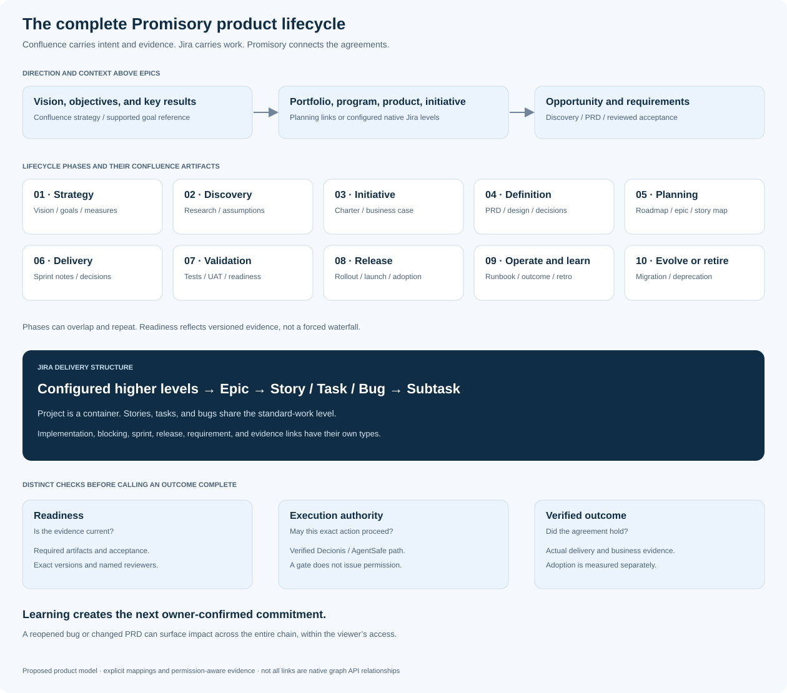

# Promisory · Product lifecycle and traceability
**Version 1.0 · 10 November 2026 · Expanded product scope**

Promisory follows a product from its intended outcome to the evidence that the outcome was achieved. Confluence holds the reasoning, requirements, decisions, and learning; Jira holds the work; Promisory connects the agreements and responsible people across both.

Lifecycle phase, planning context, work hierarchy, and execution permission are separate dimensions. Discovery can continue during delivery. A product can have initiatives in several phases at once. These phases guide visibility and evidence; they do not impose a mandatory waterfall process.

## 1. The complete model above and below epics

| Layer | Examples | Representation |
|---|---|---|
| Direction | Product vision, strategic objective, OKR/key result, theme | Confluence strategy/OKR reference, supported Atlassian goal, or explicit Promisory planning node |
| Investment and coordination | Portfolio, program, product, initiative | Planning relationships; genuine Jira custom parents only where the tenant has configured them |
| Discovery and definition | Opportunity, idea, experiment, business case, PRD, capability/feature brief, design decision | Versioned source artifacts and typed links to outcomes and work |
| Delivery hierarchy | Configured levels above epic → epic → story/task/bug → subtask | Native Jira hierarchy discovered from metadata |
| Scheduling | Roadmap horizon, milestone, sprint, release/version | Scheduling associations; not fabricated parent levels |
| Verification and operation | Test evidence, UAT, deployment, service runbook, adoption measure, incident, retrospective | Evidence, readiness criteria, and follow-up commitments |
| Renewal or retirement | Improvement, migration, deprecation, end-of-life | New scoped commitments with explicit beneficiaries and acceptance conditions |

The default native Jira hierarchy is **Epic → Story / Task / Bug → Subtask**. A story, task, and bug are normally peers. A story can have implementation subtasks; a separate task can implement a story through a confirmed link; a bug can block either. A test or spike uses its actual configured work type. Do not assume test-management plugins or invent a native “test” hierarchy.

Above epics, an organization might configure **Program → Initiative → Epic** or another naming scheme. Those higher native levels depend on Jira Premium/Enterprise and administrator configuration. Promisory reads that configuration and never changes the site's hierarchy during installation. A product, goal, portfolio, feature, or initiative is not automatically a Jira parent simply because its name sounds larger. [Official custom hierarchy guidance](https://support.atlassian.com/jira-software-cloud/docs/configure-custom-hierarchy-levels-in-advanced-roadmaps/)

Without native higher levels, use explicit **planning links** from a Confluence initiative or a Promisory planning record to an epic. Label the link “supports initiative”; do not draw it as a native parent. This preserves useful top-level context for Jira Standard installations.

## 2. Lifecycle phases, artifacts, people, and exit evidence

Every phase has a named coordinator, permitted contributors, source references, and a visible state. The designated reviewer comes from an explicit role binding; a document owner or senior title is not sufficient authority.

| Phase | Confluence artifacts and connected work | Accountable / participating roles | Evidence needed to move forward |
|---|---|---|---|
| 1. Strategy and outcomes | Product vision, strategy brief, goals/OKRs, baseline and target measures; optional Atlassian goal link | Product leader or sponsor; product manager, business stakeholders | Named outcome, baseline or explicit baseline gap, target, beneficiary, owner, and review horizon |
| 2. Opportunity and discovery | Opportunity brief, customer research, problem statement, assumptions, experiments; linked discovery idea where available | Product manager; researcher, designer, customer/account representative, engineer | Supported problem, recorded assumptions, evidence quality, alternatives, and a proceed/hold decision |
| 3. Initiative and investment | Initiative charter, business case, scope boundaries, stakeholder map, roadmap hypothesis; portfolio/program context where used | Sponsor / initiative owner; finance, delivery manager, product owner, team leads | Explicit investment/scope decision and owners; tentative roadmap dates remain distinct from accepted commitments |
| 4. Definition and design | PRD, numbered requirements, user journeys, design references, architecture decisions, nonfunctional requirements, dependency assumptions | Product owner; designer, architect, security/reliability representatives, QA lead | Reviewed requirements and measurable acceptance conditions, with source versions and unresolved questions |
| 5. Planning and decomposition | Project plan, epic brief, story map, release plan, sprint goals; configured program/initiative → epic → story/task/bug | Delivery manager / product owner; subteam leads, scrum facilitator, engineers, testers | Required work linked to requirements, dependencies confirmed, ownership accepted, scope/date assumptions visible |
| 6. Delivery and collaboration | Sprint notes, decision log, impediments, technical notes; stories, tasks, bugs, subtasks and spikes as configured | Team lead; engineers, testers, scrum participants, product owner | Current progress evidence, resolved blockers or explicit exceptions, decisions applied to the correct versions |
| 7. Validation and readiness | Test strategy/results, UAT record, acceptance checklist, release readiness review, rollout/rollback and support handover | QA / release owner; product owner, service owner, authorized approvers | Required tests and human acceptance, current PRD applicability, known defects, service readiness; a documented go/hold decision |
| 8. Release and adoption | Launch plan, release notes, deployment reference, stakeholder/customer communication plan, adoption baseline | Release / product owner; engineering, support, account owner, marketing where relevant | Actual release evidence plus the separately agreed customer/business acceptance; communications require their own authorization |
| 9. Operate and learn | Runbook, service measures, feedback, incident/postmortem, retrospective, outcome review | Service / product owner; support, engineers, scrum facilitator, stakeholders | Observed outcome against target, remaining gaps, and assigned improvement commitments; release alone does not prove adoption |
| 10. Evolve or retire | Improvement roadmap, migration plan, deprecation notice, end-of-life checklist, archival decision | Product / service owner; customer owner, engineering, data owner | Migration/retirement criteria, affected stakeholder agreement, verified completion, and retention/disposal decisions |

The artifact names are recommended templates, not claims that Confluence provides a built-in approval engine or universal lifecycle schema. Promisory records its own versioned review and gate state and links to any supported native status as context. [Confluence product-management templates](https://www.atlassian.com/software/confluence/templates/collections/product-managers) · [Project lifecycle templates](https://www.atlassian.com/software/confluence/templates/collections/project-management)

## 3. Confluence space blueprint

The following page tree is a reusable organization pattern. Existing spaces can map their own pages to the same roles without moving or renaming content.

~~~text
Product home: Merchant Experience
  Strategy and outcomes
    Vision, goals, and measures
    Portfolio / program context
  Discovery and opportunities
    Research and problem evidence
    Assumptions, experiments, and decisions
  Initiatives and roadmap
    Initiative charter and business case
    Roadmap and investment decisions
  Requirements and design
    Product requirements document
    Experience and architecture decisions
  Delivery
    Project and epic briefs
    Story map, sprint goals, and decision log
  Validation and release
    Test / UAT evidence
    Release readiness and rollout plan
    Release notes and stakeholder updates
  Operate and learn
    Runbooks and support handover
    Outcome review, incidents, and retrospective
  Evolution and retirement
    Improvement, migration, and deprecation plans
~~~

A Confluence page tree is document organization. It is not imported as Jira work-item ancestry. A PRD can define several epics, and several source documents can support one initiative. Preserve these many-to-many relationships.

P0 lets an authorized user select existing pages and map their artifact roles. P1 can prepare these templates for a separately authorized page-creation workflow. Do not automatically publish a new document tree into a customer's space.

## 4. Requirement-to-outcome traceability

Use stable Promisory requirement IDs attached to a page ID, source revision, section reference, and content fingerprint. A heading name alone is not stable enough. If editing makes a section ambiguous, ask for a new confirmed mapping before using it as evidence.

Example trace:

~~~text
Product objective: merchants can onboard without duplicate events
  Initiative: self-service merchant activation
    PRD v3 / REQ-07: one activation per merchant request
      defines → Epic MX-100
      implemented by → Story MX-110
      implemented by → Task MX-121
      blocked by ← Bug MX-137
      decomposed into → Subtask MX-122 (native child of Task MX-121)
      verified by → acceptance test + production evidence
    supports → Commitment PM-101, due 20 November
  measured by → post-launch activation / duplication measure
~~~

The indentation above groups the trace for reading. Only the explicitly labelled native child is a task parent relationship; source, implementation, blocking, and verification links have their own types. A confirmed task-to-story relationship can provide the requested epic → story → task → bug trace without falsely making standard Jira tasks children of standard stories.

Useful relationship types include ALIGNS_TO, DEFINES, IMPLEMENTS, BLOCKS, SUPPORTS, SCHEDULED_FOR, VERIFIES, MEASURED_BY, and INFORMS. Native PARENT_OF is reserved for relationships Jira actually reports. Every inferred relationship is a suggestion until confirmed or established by an authoritative source.

Rovo should answer both directions: “Which initiative and requirements does this bug threaten?” and “Which evidence proves this product outcome?” Teamwork Graph supplies permitted team/goal/work context where supported; Confluence/Jira APIs and explicit mappings supply the artifact and requirement details. Do not assume every conceptual relationship exists in Teamwork Graph's public schema.

## 5. Versioned lifecycle readiness

A LifecycleGate links a phase, its required artifacts, acceptance conditions, named reviewers, and the exact versions reviewed. Its state is UNKNOWN, NOT_READY, READY_FOR_REVIEW, ACCEPTED, HELD, SUPERSEDED, or NOT_APPLICABLE. NOT_APPLICABLE requires a recorded authorized reason; it cannot be a silent bypass.

A release-readiness gate might require PRD REQ-07 v3, a passing test reference, current owner acceptance, a support handover, and a rollback plan. Those are configurable criteria, not universal requirements for every team.

When the PRD changes, Promisory compares the referenced version and content fingerprint. A material change, unresolved section mapping, removed acceptance condition, or changed linked work creates a reassessment. Keep the historic review intact; mark its applicability stale. A previously accepted document or ready gate does not authorize a deployment or Jira mutation.

Show **delivery health** and **lifecycle readiness** separately. A release can have no overdue engineering tasks while still lacking required product acceptance. A strategic outcome can remain unmeasured even when all related epics are closed.

Roll up deduplicated commitments and explicit requirement/gate coverage. Do not add story-point totals to adoption percentages, treat “90% of tasks closed” as “90% of the outcome achieved,” or expose restricted issue counts through a higher-level overview.

## 6. Expanded workflows

**Product manager begins with a PRD.** Select a permitted Confluence page and its relevant version. Confirm the outcome, requirements, initiative context, responsible people, acceptance conditions, and proposed commitments. Link existing work. Owner acceptance activates a commitment; extraction alone does not.

**A requirement changes after planning.** Observe the source change, identify the confirmed references affected, flag their requirement and gate applicability, and show the epic/story/task/bug paths. The product owner reviews scope; the delivery owner assesses the promise impact. Keep the previous agreed promise until a separate revision is accepted.

**An engineer reopens a bug.** Trace from the bug through the blocked story/task and supporting commitment to the initiative and product goal. Show the relevant PRD section, responsible team, and release gate affected. Each audience receives only the permitted explanation and the action relevant to its role.

**A release ships.** Attach actual release evidence, evaluate the agreed conditions, and obtain any required customer acceptance. Start or update an outcome-measurement window when appropriate. A release may fulfill a delivery promise while a separate adoption commitment remains active.

**A retrospective creates follow-through.** Capture a reviewable improvement candidate linked to the incident, outcome gap, or retrospective decision. Confirm the owner and acceptance conditions before activation. New learning informs the next discovery cycle without rewriting historic outcomes.

## 7. Bounded implementation and acceptance

All ten phases belong in the product model and navigation. P0 demonstrates one continuous trace: **goal → initiative → Confluence PRD → epic → story / task / bug → release-readiness evidence → commitment**. Use one project, one configured initiative level or explicit planning-link alternative, a handful of selected pages, and one versioned release-readiness gate.

P0 includes requirement/source mapping, actual hierarchy discovery, phase context, basic gate readiness, and the impact of a changed requirement or bug. It does not require a complete portfolio-planning engine, external analytics connector, automated funding decision, or production deployment integration. Expanded gate templates and retrospective follow-through are P1; predictive planning and automated retirement are P2.

Acceptance evidence must demonstrate:

- Native higher levels when present, and a clearly labelled planning-link path when absent.
- A story, task, and bug as standard work peers, plus a real subtask.
- A Confluence page version tied to a stable requirement and Jira work references.
- A changed requirement invalidating the appropriate current gate applicability.
- A bug affecting a commitment and its initiative without duplicate rollups.
- A ready/accepted gate remaining distinct from execution authority and verified business outcomes.
- Restricted Confluence content omitted from Jira views, Rovo answers, counts, and external serialization.
- Release evidence and a later adoption/outcome measure remaining independently assessable.

See the [technical specification](01-technical-specification.md), [implementation plan](03-implementation-plan.md), and [Codex instructions](04-codex-implementation-instructions.md) for the shared contracts and delivery gates.
